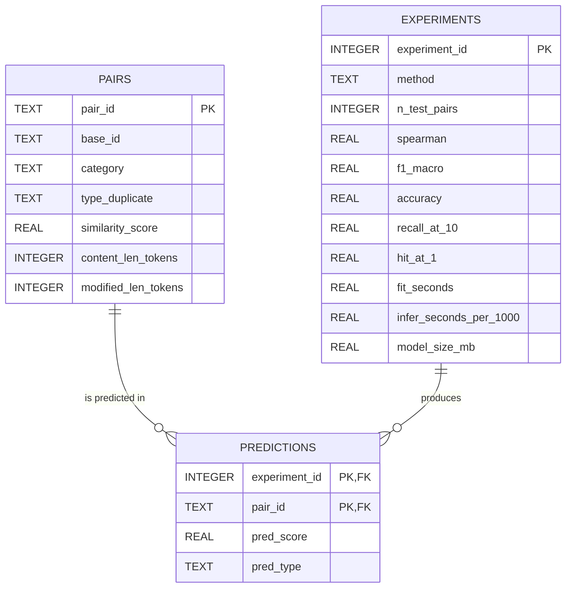

# Lightweight Kazakh Near-Duplicate Detector

Final project for **Programming for Data Analysis and Database** (Applied Artificial Intelligence, MSc), topic 25.

**Team:** Temirlan Koshkimbay, Zhanserik Batyrkhanov (group AAI-2604M)

## Goal

Analyze duplicate types in Kazakh documents and build a compact transformer for similarity scoring and duplicate-type classification. Four approaches are compared on the same held-out data: a TF-IDF baseline, MinHash/LSH, zero-shot `multilingual-e5-small`, and the same model fine-tuned on this dataset.

## Dataset

- **KazakhTextDuplicates v2.0**: 207,376 document pairs, 25,922 original documents, 7 duplicate types
- Source: https://huggingface.co/datasets/Arailym-tleubayeva/KazakhTextDuplicatesv2.0
- The 1.77 GB CSV is not stored in this repository. Put it in `data/raw/` (see *How to run*).

### Exploratory analysis

| Duplicate type | Pairs | Share | Similarity score |
|---|---|---|---|
| partial | 58,312 | 28.1% | 0.40 |
| exact | 32,519 | 15.7% | 1.00 |
| contextual | 32,340 | 15.6% | 0.70 |
| noisy_medium | 25,922 | 12.5% | 0.75 |
| noisy_hard | 25,922 | 12.5% | 0.55 |
| noisy_soft | 25,922 | 12.5% | 0.90 |
| paraphrase | 6,439 | 3.1% | 0.85 |

- Every original document has one variant of each noisy type. Its exact copy and its partial and contextual variants vary in number.
- The original text is repeated across variants (181,454 rows repeat an earlier `content`).
- Token lengths are filled in only for the 25,922 rows of one group. Median document length is 153 tokens, 90th percentile 725, maximum 2,904.

### Data leakage in the official split

The official train/validation/test split is **not group-aware**:

- 99.85% of official test rows (45,005 of 45,073) have identical text in train.
- 19,745 original documents appear in both train and test, although the dataset card claims "no identifier overlap".

To evaluate honestly, all rows are pooled and re-split **by original document** (`src/splits.py`, `GroupShuffleSplit`, seed 42):

| Split | Rows | Original documents | Shared originals with other splits |
|---|---|---|---|
| train | 145,152 | 18,144 | 0 |
| validation | 20,744 | 2,593 | 0 |
| test | 41,480 | 5,185 | 0 |

A residual check on this split (`results/leakage_report.json`) found 24 test rows with identical text in train (0.06%) and 168 near-duplicates with MinHash Jaccard ≥ 0.8 (0.41%). These come from different original documents and are kept in the evaluation.

## Methods

| Method | What it does |
|---|---|
| `tfidf_cosine` (baseline) | Cosine similarity over word 1–2-gram and char_wb 3–5-gram TF-IDF |
| `minhash_lsh` | Jaccard of MinHash signatures over word 5-gram shingles (datasketch, LSH for retrieval) |
| `e5_zero_shot` | `intfloat/multilingual-e5-small` embeddings, no training (FAISS for retrieval) |
| `e5_finetuned` | The same model fine-tuned for 1 epoch on the full group train split with CoSENT regression on `similarity_score` |

Duplicate-type classification uses logistic regression on the validation split. Embedding methods use features `|u−v|`, `u⊙v` and cosine. Baseline methods use the similarity score alone. A majority-class classifier is included as the simplest baseline.

## Results

Test split: 41,480 pairs (similarity and type). Retrieval: 5,000 random test queries against the non-exact variants of the test documents. A query is relevant to every variant of the same original document.

| Method | Macro-F1 | Accuracy | Spearman | Recall@1 | Recall@5 | Recall@10 | hit@1 | Sec / 1000 pairs | Size (MB) |
|---|---|---|---|---|---|---|---|---|---|
| majority baseline | 0.063 | 0.280 | – | – | – | – | – | 0.0 | – |
| TF-IDF cosine | 0.366 | 0.404 | **0.496** | 0.149 | 0.745 | **0.999** | 1.000 | 25.2 | 16.8 |
| MinHash LSH | 0.387 | 0.428 | 0.320 | 0.149 | 0.741 | 0.854 | 1.000 | **4.9** | – |
| e5-small zero-shot | 0.464 | 0.496 | 0.285 | 0.149 | 0.745 | 0.989 | 1.000 | 6.4 | 470.6 |
| **e5-small fine-tuned** | **0.611** | **0.642** | 0.440 | 0.149 | 0.689 | 0.755 | 1.000 | 7.3 | 470.6 |

Notes:
- Recall@k is capped at about 1/|relevant| ≈ 0.15 for Recall@1, because each query has about 7 relevant documents.
- hit@k (at least one relevant document in the top k) is saturated at 1.0 for every method, so Recall@k is the informative retrieval metric.
- Model size is fp32 weights. TF-IDF size is the pickled vectorizer. MinHash has no learned parameters.
- Timings were measured on an RTX 3070 Laptop GPU (8 GB) for the embedding methods; the TF-IDF and MinHash timings are CPU.

Per-type accuracy of the fine-tuned model (SQL query Q2): exact 0.761, noisy_medium 0.650, noisy_soft 0.642, contextual 0.602, partial 0.547, paraphrase 0.410.

Accuracy falls with document length (SQL query Q9): 0.74 for under 100 tokens, 0.64 for 100–299, 0.55 for 300–599, 0.54 for 600+ (5,185 pairs with length information).

Observations:
- The fine-tuned model is best for type classification (macro-F1 0.61) and second for similarity correlation. TF-IDF has the best Spearman (0.50).
- Fine-tuning lowers Recall@10 (0.99 → 0.76). A likely cause is that low-similarity `partial` variants (score 0.40) are pushed away from the query by the regression objective. This is a hypothesis we did not verify.
- MinHash is the fastest method and needs no training, but it has the weakest recall among the embedding-free methods.

## Database

Results are stored in SQLite (`data/duplicates.db`). The ER diagram is:



`src/sql_queries.py` contains 10 report queries that use JOIN, GROUP BY/HAVING, correlated subqueries, CTEs and window functions (ROW_NUMBER, RANK, SUM OVER). They are run from menu item 7; the CSV outputs go to `results/sql/`.

## Project structure

```
main.py                 console menu (8 actions)
src/config.py           paths, model names and hyperparameters
src/data.py             chunked CSV -> Parquet, split loading, EDA
src/splits.py           group-aware train/validation/test split
src/leakage.py          train-test overlap check (exact and MinHash LSH)
src/text_utils.py       normalisation and MinHash helpers
src/baseline.py         TF-IDF and MinHash baselines, LSH and sparse top-k retrieval
src/model.py            e5-small zero-shot and fine-tuning (sentence-transformers), FAISS
src/evaluate.py         benchmark: metrics, retrieval, classifier, saved predictions
src/storage.py          SQLite schema and queries
src/sql_queries.py      10 named SQL report queries
requirements.txt
```

## Course requirements

1. Functional programming: more than five helper functions outside `main`, for example `convert_csv_to_parquet`, `run_eda`, `build_grouped_split`, `run_benchmark`.
2. Data structures: lists, dicts and DataFrames throughout.
3. Conditionals: `if`/`elif`/`else` in the menu, the length buckets and the data checks.
4. Loops: `for` over chunks, the menu `while` loop and the retrieval loops.
5. File I/O: CSV read in chunks, Parquet, JSON reports, CSV query results, joblib model file, SQLite.
6. Error handling: `try`/`except` in the menu, with specific messages for missing files and bad data.
7. Interface: an interactive console menu (`python main.py`).
8. Modularity: 11 modules in `src/`.
9. Justification: four approaches (TF-IDF, MinHash, zero-shot e5, fine-tuned e5) compared on quality, time and memory.
10. Database: SQLite with an ER diagram and 10 SQL queries, loaded into pandas.
11. Data volume: 207,376 rows and a 1.77 GB CSV, read in chunks and stored as Parquet.

## How to run

```bash
pip install -r requirements.txt
```

Download `KazakhTextDuplicates_v2.csv` from the dataset page and place it at `data/raw/KazakhTextDuplicates_v2.csv`. Then start the menu:

```bash
python main.py
```

Recommended order:
1. Convert CSV to Parquet.
2. EDA.
3. Group-aware split.
4. Leakage check.
5. Fine-tune e5-small (about 35 minutes on an RTX 3070; CPU is possible but much slower).
6. Benchmark all methods and save to SQLite.
7. SQL report.
8. Enter two texts to get a similarity score and a predicted duplicate type (needs steps 5 and 6).

## Limitations

- The official split leaks; all results use our group-aware split instead.
- Fine-tuning ran for one epoch with a 256-token limit, so longer documents are truncated.
- Length information is available only for a subset of rows, so length analysis covers that subset.
- Retrieval is evaluated on 5,000 sampled queries, not on the full test split.
