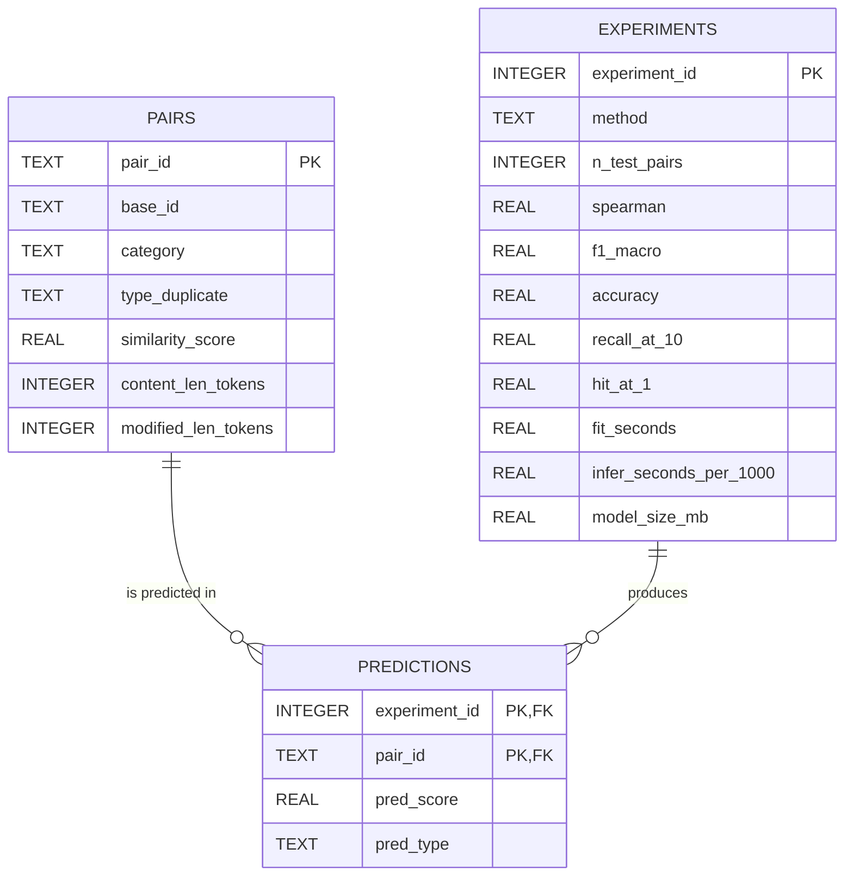

# Lightweight Kazakh Near-Duplicate Detector

Final project for **Programming for Data Analysis and Database** (Applied Artificial Intelligence, MSc), topic 25.

**Team:** Temirlan Koshkimbay, Zhanserik Batyrkhanov (group AAI-2604M)

## Goal

Analyze duplicate types in Kazakh documents and build a compact transformer for similarity scoring and duplicate-type classification. Four approaches are compared on the same held-out data: a TF-IDF baseline, MinHash/LSH, zero-shot `multilingual-e5-small`, and the same model fine-tuned on this dataset.

## Dataset

- **KazakhTextDuplicates v2.0**: 207,376 document pairs, 25,922 original documents, 7 duplicate types
- Source: https://huggingface.co/datasets/Arailym-tleubayeva/KazakhTextDuplicatesv2.0
- The 1.77 GB CSV is not stored in this repository. Put it in `data/raw/` (see *How to run*).

### Exploratory analysis

| Duplicate type | Pairs | Share | Similarity score |
|---|---|---|---|
| partial | 58,312 | 28.1% | 0.40 |
| exact | 32,519 | 15.7% | 1.00 |
| contextual | 32,340 | 15.6% | 0.70 |
| noisy_medium | 25,922 | 12.5% | 0.75 |
| noisy_hard | 25,922 | 12.5% | 0.55 |
| noisy_soft | 25,922 | 12.5% | 0.90 |
| paraphrase | 6,439 | 3.1% | 0.85 |

- Every original document has one variant of each noisy type. Its exact copy and its partial and contextual variants vary in number.
- The original text is repeated across variants (181,454 rows repeat an earlier `content`).
- Token lengths are filled in only for the 25,922 rows of one group. Median document length is 153 tokens, 90th percentile 725, maximum 2,904.

### Data leakage in the official split

The official train/validation/test split is **not group-aware**:

- 99.85% of official test rows (45,005 of 45,073) have identical text in train.
- 19,745 original documents appear in both train and test, although the dataset card claims "no identifier overlap".

To evaluate honestly, all rows are pooled and re-split **by original document** (`src/splits.py`, `GroupShuffleSplit`, seed 42):

| Split | Rows | Original documents | Shared originals with other splits |
|---|---|---|---|
| train | 145,152 | 18,144 | 0 |
| validation | 20,744 | 2,593 | 0 |
| test | 41,480 | 5,185 | 0 |

A residual check on this split (`results/leakage_report.json`) found 24 test rows with identical text in train (0.06%) and 168 near-duplicates with MinHash Jaccard ≥ 0.8 (0.41%). These come from different original documents and are kept in the evaluation.

## Methods

| Method | What it does |
|---|---|
| `tfidf_cosine` (baseline) | Cosine similarity over word 1–2-gram and char_wb 3–5-gram TF-IDF |
| `minhash_lsh` | Jaccard of MinHash signatures over word 5-gram shingles (datasketch, LSH for retrieval) |
| `e5_zero_shot` | `intfloat/multilingual-e5-small` embeddings (117.65M parameters, 470.6 MB fp32), no fine-tuning (FAISS for retrieval) |
| `e5_finetuned` | The same model fine-tuned for 1 epoch (`MAX_SEQ_LENGTH = 512`, `TRAIN_BATCH_SIZE = 32`): CoSENT regression on all types except `partial` plus `MultipleNegativesRankingLoss` on every non-exact variant |
| `<method>+lex` | Gradient boosting on the method's features (for encoders: 11 embedding summary stats + out-of-fold class probabilities) plus 30 untruncated lexical features (`src/lexical.py`); the regressor predicts similarity for Spearman |
| `lexical_features` | The 30 lexical features alone, no neural model, as a fast reference |

Duplicate-type classification uses the validation split (`20,744` pairs). Plain embedding methods use an `MLPClassifier(128)` and `Ridge(alpha=5000)` over `|u−v|`, `u−v`, `u⊙v`, and 11 summary features (8 blockwise cosines, L1, L2, cosine); scalar baselines (`tfidf_cosine`, `minhash_lsh`) use logistic regression and their raw similarity score. A majority-class classifier is the simplest baseline.

## Results (v3, current code)

Measured on an RTX 5060 Ti (16 GB) for embeddings (`batch_size=128`, fp16 autocast, deduplicated text encoding) and Ryzen 5 7500F CPU for TF-IDF, MinHash, and gradient boosting. Test split: `41,480` pairs; retrieval: `5,000` test queries.

| Method | Macro-F1 | Accuracy | Spearman | Recall@10 | Sec / 1000 pairs | Size (MB) |
|---|---|---|---|---|---|---|
| majority baseline | 0.063 | 0.280 | – | – | 0.00 | – |
| TF-IDF cosine | 0.366 | 0.404 | 0.496 | **0.999** | 5.61 | 18.4 |
| TF-IDF cosine + lex | 0.913 | 0.939 | 0.954 | – | 6.49 | 18.4 |
| MinHash LSH | 0.387 | 0.428 | 0.320 | 0.854 | **0.65** | – |
| MinHash LSH + lex | 0.914 | **0.939** | 0.955 | – | 1.53 | – |
| e5-small zero-shot | 0.662 | 0.707 | 0.571 | 0.994 | 1.83 | 470.6 |
| e5-small zero-shot + lex | **0.914** | 0.939 | 0.955 | – | 2.70 | 470.6 |
| e5-small fine-tuned | 0.713 | 0.752 | 0.535 | 0.997 | 1.83 | 470.6 |
| **e5-small fine-tuned + lex** | **0.914** | 0.939 | **0.960** | – | 2.70 | 470.6 |
| lexical features only | 0.914 | 0.939 | 0.954 | – | 0.88 | – |

What v3 improved over v2:
- **Plain transformer scoring:** adding directional difference (`u−v`), blockwise cosines/norms, `MLPClassifier(128)`, and `Ridge` regression lifted plain `e5_finetuned` from `0.611` → **`0.752` Accuracy** (`0.585` → **`0.713` Macro-F1**, `0.320` → **`0.535` Spearman**) while keeping **`0.997` Recall@10**; plain `e5_zero_shot` jumped from `0.542` → **`0.707` Accuracy** (`0.499` → **`0.662` Macro-F1**).
- **Character n-grams & OOF hybrid features:** adding char 4-gram Jaccard/containment, word bigrams, positional word alignment, exact raw/normalized flags, and encoder summary + OOF probabilities pushed `+lex` hybrids to **`0.939` Accuracy**, **`0.914` Macro-F1**, and **`0.960` Spearman** (improving `paraphrase` F1 to `0.795–0.798`).
- **Inference speedup:** deduplicating repeated texts before TF-IDF, MinHash, and `e5` encoding (plus fp16 autocast on GPU) sped up embedding inference from `12.0–13.1` to **`1.83–2.70` sec / 1000 pairs** (~4.7–6.5× faster).
- **Irreducible noise ceiling:** `1,214` of `41,480` test pairs (`2.93%`) have identical strings (`content == modified_content`) yet carry non-`exact` labels (`670` `contextual`, `352` `paraphrase`, `99` `noisy_soft`, `93` `partial`), placing a practical ceiling around ~`97.1%` accuracy.
- **Length effect (SQL query Q9, `e5_finetuned+lex`):** accuracy rises steadily with document length: `0.855` (<100 tokens), `0.942` (100–299), `0.975` (300–599), and `0.993` (600+).

## Results (v2, prior baseline before v3 improvements)

Same test split and retrieval setup as v1. Rows marked `+lex` add lexical features with gradient boosting; their retrieval is the base method's, so Recall is shown only for base rows.

| Method | Macro-F1 | Accuracy | Spearman | Recall@10 | Sec / 1000 pairs | Size (MB) |
|---|---|---|---|---|---|---|
| majority baseline | 0.063 | 0.280 | – | – | 0.0 | – |
| TF-IDF cosine | 0.366 | 0.404 | 0.496 | 0.999 | 20.5 | 16.8 |
| TF-IDF cosine + lex | 0.883 | 0.925 | 0.945 | – | 21.2 | 16.8 |
| MinHash LSH | 0.387 | 0.428 | 0.320 | 0.854 | 4.8 | – |
| MinHash LSH + lex | 0.881 | 0.924 | 0.946 | – | 5.5 | – |
| e5-small zero-shot | 0.499 | 0.542 | 0.380 | 0.994 | 12.4 | 470.6 |
| e5-small zero-shot + lex | 0.883 | 0.925 | 0.945 | – | 13.1 | 470.6 |
| e5-small fine-tuned (v2) | 0.585 | 0.611 | 0.320 | **0.997** | 12.0 | 470.6 |
| **e5-small fine-tuned (v2) + lex** | **0.888** | **0.928** | 0.945 | – | 12.7 | 470.6 |
| lexical features only | 0.881 | 0.924 | **0.946** | – | **0.7** | – |

What v2 changed:
- Recall@10 of the fine-tuned model is back to 0.997 (v1: 0.755). Partial variants are retrievable again, so the v2 fix addressed the retrieval drop.
- But the regression objective got weaker: Spearman fell from 0.440 (v1) to 0.320, and plain macro-F1 from 0.611 to 0.585. Partial pairs now score 0.38 accuracy as a type, so the fine-tuned score is not a good similarity signal on its own.

The main finding of v2 is that lexical features alone reach macro-F1 0.881 and Spearman 0.946 at 0.7 seconds per 1000 pairs. The embedding adds only +0.007 F1 on top (0.888 vs 0.881) at about 18 times the cost. On this dataset, duplicate type and similarity follow from how the text was edited, which word and n-gram overlap measure directly. This is a property of the dataset construction, and it means the lexical baseline is strong evidence for what the labels encode.

Length effect (SQL query Q9, hybrid model): accuracy rises with document length, from 0.82 for under 100 tokens to 0.98 for 600+. This is the reverse of v1, where the plain model was worse on long documents, so the lexical features are doing the work on long texts.

## Results (v1, produced before the fixes described below)

Test split: 41,480 pairs (similarity and type). Retrieval: 5,000 random test queries against the non-exact variants of the test documents. A query is relevant to every variant of the same original document.

| Method | Macro-F1 | Accuracy | Spearman | Recall@1 | Recall@5 | Recall@10 | hit@1 | Sec / 1000 pairs | Size (MB) |
|---|---|---|---|---|---|---|---|---|---|
| majority baseline | 0.063 | 0.280 | – | – | – | – | – | 0.0 | – |
| TF-IDF cosine | 0.366 | 0.404 | **0.496** | 0.149 | 0.745 | **0.999** | 1.000 | 25.2 | 16.8 |
| MinHash LSH | 0.387 | 0.428 | 0.320 | 0.149 | 0.741 | 0.854 | 1.000 | **4.9** | – |
| e5-small zero-shot | 0.464 | 0.496 | 0.285 | 0.149 | 0.745 | 0.989 | 1.000 | 6.4 | 470.6 |
| **e5-small fine-tuned** | **0.611** | **0.642** | 0.440 | 0.149 | 0.689 | 0.755 | 1.000 | 7.3 | 470.6 |

Notes:
- Recall@k is capped at about 1/|relevant| ≈ 0.15 for Recall@1, because each query has about 7 relevant documents.
- hit@k (at least one relevant document in the top k) is saturated at 1.0 for every method, so Recall@k is the informative retrieval metric.
- Model size is fp32 weights. TF-IDF size is the pickled vectorizer. MinHash has no learned parameters.
- Timings were measured on an RTX 3070 Laptop GPU (8 GB) for the embedding methods; the TF-IDF and MinHash timings are CPU.

Per-type accuracy of the fine-tuned model (SQL query Q2): exact 0.761, noisy_medium 0.650, noisy_soft 0.642, contextual 0.602, partial 0.547, paraphrase 0.410.

Accuracy falls with document length (SQL query Q9): 0.74 for under 100 tokens, 0.64 for 100–299, 0.55 for 300–599, 0.54 for 600+ (5,185 pairs with length information).

Observations:
- The fine-tuned model is best for type classification (macro-F1 0.61) and second for similarity correlation. TF-IDF has the best Spearman (0.50).
- Fine-tuning lowers Recall@10 (0.99 → 0.76). A likely cause is that low-similarity `partial` variants (score 0.40) are pushed away from the query by the regression objective. This is a hypothesis we did not verify.
- MinHash is the fastest method and needs no training, but it has the weakest recall among the embedding-free methods.

## Why v1 behaved this way, and what v2 changes

These causes come from the saved v1 predictions and from the text pairs. The v2 fixes were run and measured; their effect is in the v2 results above.

1. **The duplicate type is defined by how the text was edited, not by meaning.** Word overlap between a document and its variant, by subtype (400 test pairs each):

   | Subtype | Relation to the original | Word Jaccard | Length ratio |
   |---|---|---|---|
   | exact | identical | 1.00 | 1.00 |
   | ctx (contextual) | same words, different order | 1.00 | 1.00 |
   | partial_ext | original is fully contained, short tail added | 0.95 | 1.03 |
   | partial_cut | variant is the first ~70% of the original | 0.72 | 0.71 |
   | noisy_soft / medium / hard | character-level corruption | 0.91 / 0.77 / 0.61 | 0.99 / 0.98 / 0.95 |

   A semantic embedding hides these cues. After fine-tuning, all types except `partial` have mean cosine 0.95–1.00 (a gap of 0.01–0.03 between types), so a classifier on the cosine cannot separate them well.

2. **The scores are per type and contradict the real overlap.** `partial_ext` shares 95% of its words with the original but is labelled 0.40, below `noisy_hard` (61% overlap, label 0.55). CoSENT regression had to place near-identical texts below corrupted ones, which is why the loss only fell from 5.92 to 5.64. The model's only way out was to push all `partial` pairs down: their mean cosine fell from 0.986 (zero-shot) to 0.724, with a minimum of −0.42. Those variants then dropped out of the retrieval top-10, which explains Recall@10 falling from 0.99 to 0.76. Unrelated documents were not measured directly, so this part is a strong but not fully verified explanation.

3. **The input was truncated.** Measured on 1,500 test documents with the e5 tokenizer: 2.08 tokens per Kazakh word and a median of 333 tokens (165 words). 58.5% of documents were longer than the 256-token limit, which covered only about 123 words. `partial_cut` and `partial_ext` differ at the end of the text, where the model could not see. 36% of `partial` pairs (4,189 of 11,618) were predicted as `exact`.

4. **CoSENT alone has no negatives.** It only orders the cosines of the pairs in a batch and never pushes different originals apart, which retrieval needs.

Changes in v2:

- `src/model.py`: CoSENT regression without `partial` plus `MultipleNegativesRankingLoss` on all non-exact variants (so partial variants are positives). `NO_DUPLICATES` batches stop variants of one original from acting as false negatives for each other.
- `src/config.py`: `MAX_SEQ_LENGTH` 256 → 512, batch 32 → 16 to fit an 8 GB GPU, 60,000 rows per objective.
- `src/lexical.py` (new): length ratios, word and trigram containment and Jaccard, common prefix/suffix and "shorter text is a prefix", computed on the full untruncated texts.
- `src/evaluate.py`: each method also gets a `+lex` hybrid (gradient boosting classifier and regressor), plus a lexical-only reference row.
- `main.py`: the interactive prediction and the SQL report use the fine-tuned hybrid `e5_finetuned+lex`.

v2 training took 46 minutes on the RTX 3070 with 512 tokens and batch 16 (7,500 steps, round-robin over the two objectives). 512 tokens cover about 246 words, so 35.1% of documents are still truncated; the lexical features, computed on the full text, cover that gap, and the results above show they do.

## Database

Results are stored in SQLite (`data/duplicates.db`). The ER diagram is:



`src/sql_queries.py` contains 10 report queries that use JOIN, GROUP BY/HAVING, correlated subqueries, CTEs and window functions (ROW_NUMBER, RANK, SUM OVER). They are run from menu item 7; the CSV outputs go to `results/sql/`.

## Project structure

```
main.py                 console menu (8 actions)
src/config.py           paths, model names and hyperparameters
src/data.py             chunked CSV -> Parquet, split loading, EDA
src/splits.py           group-aware train/validation/test split
src/leakage.py          train-test overlap check (exact and MinHash LSH)
src/text_utils.py       normalisation and MinHash helpers
src/lexical.py          length / containment / n-gram / prefix features of a text pair
src/baseline.py         TF-IDF and MinHash baselines, LSH and sparse top-k retrieval
src/model.py            e5-small zero-shot and fine-tuning (sentence-transformers), FAISS
src/evaluate.py         benchmark: metrics, retrieval, classifier, saved predictions
src/storage.py          SQLite schema and queries
src/sql_queries.py      10 named SQL report queries
requirements.txt
```

## Course requirements

1. Functional programming: more than five helper functions outside `main`, for example `convert_csv_to_parquet`, `run_eda`, `build_grouped_split`, `run_benchmark`.
2. Data structures: lists, dicts and DataFrames throughout.
3. Conditionals: `if`/`elif`/`else` in the menu, the length buckets and the data checks.
4. Loops: `for` over chunks, the menu `while` loop and the retrieval loops.
5. File I/O: CSV read in chunks, Parquet, JSON reports, CSV query results, joblib model file, SQLite.
6. Error handling: `try`/`except` in the menu, with specific messages for missing files and bad data.
7. Interface: an interactive console menu (`python main.py`).
8. Modularity: 12 modules in `src/`.
9. Justification: four approaches (TF-IDF, MinHash, zero-shot e5, fine-tuned e5) compared on quality, time and memory.
10. Database: SQLite with an ER diagram and 10 SQL queries, loaded into pandas.
11. Data volume: 207,376 rows and a 1.77 GB CSV, read in chunks and stored as Parquet.

## How to run

```bash
pip install -r requirements.txt
```

Download `KazakhTextDuplicates_v2.csv` from the dataset page and place it at `data/raw/KazakhTextDuplicates_v2.csv`. Then start the menu:

```bash
python main.py
```

Recommended order:
1. Convert CSV to Parquet.
2. EDA.
3. Group-aware split.
4. Leakage check.
5. Fine-tune e5-small (v1 took about 33 minutes on an RTX 3070; v2 uses 512 tokens and two objectives, so expect longer; CPU is possible but much slower).
6. Benchmark all methods and save to SQLite (this replaces the v1 results in the database).
7. SQL report.
8. Enter two texts to get a similarity score and a predicted duplicate type (needs steps 5 and 6).

## Limitations

- The official split leaks; all results use our group-aware split instead.
- Fine-tuning ran for one epoch with a 512-token limit, so the 35.1% of documents longer than 512 tokens are still truncated by the encoder (covered by untruncated lexical features in `+lex`).
- Length information is available only for a subset of rows, so length analysis covers that subset.
- Retrieval is evaluated on 5,000 sampled queries, not on the full test split.
- Precomputed `data/duplicates.db`, `results/sql/*.csv`, and `models/*.joblib` are committed for out-of-the-box SQL reporting (step 7) and interactive prediction (step 8); the 470 MB fine-tuned encoder weights (`models/e5-small-kk-duplicates/`) exceed GitHub's 100 MB file limit, so step 8 falls back to `e5_zero_shot+lex` automatically unless `e5-small-kk-duplicates/` is present locally.
